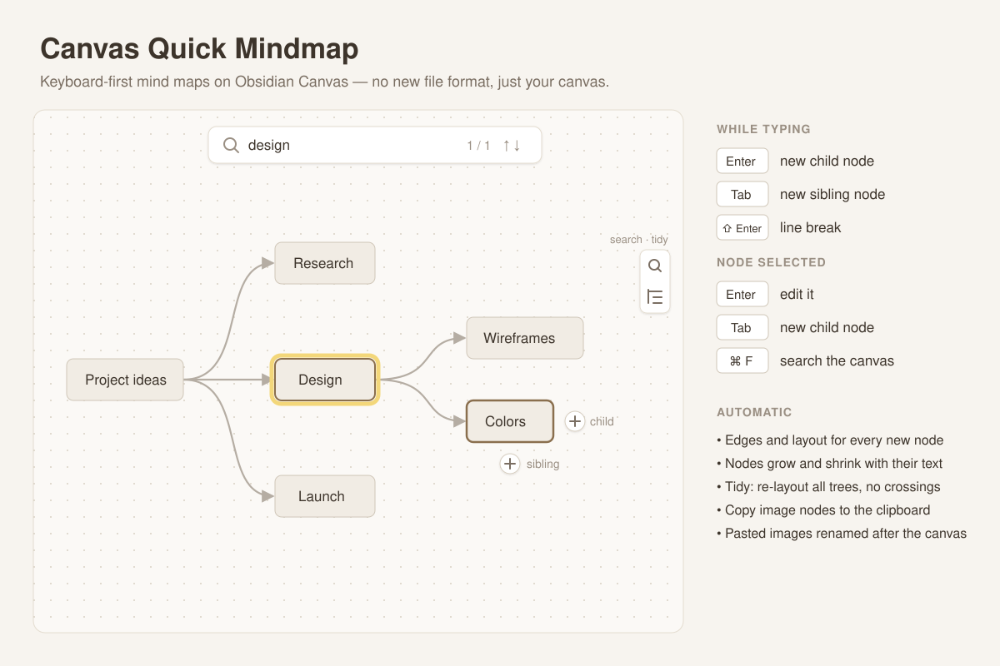

# Canvas Quick Mindmap

Obsidian Canvas is a great place to think, but building a mind map in it is slow:
create a card, drag it into place, drag an edge from one card to the other, resize,
repeat. Canvas Quick Mindmap turns that into typing. Press **Enter** and the next
idea appears to the right, already connected and ready for text. Press **Tab** and
it appears below, on the same level. The canvas stays a normal `.canvas` file —
nothing new to learn, nothing locked in.

## Features

- **Type your map.** While editing a node, **Enter** adds a child node and **Tab**
  adds a sibling. **Shift+Enter** is a line break. The new node is connected,
  placed and opened for typing.
- **Keyboard on a selected node.** **Enter** edits it (cursor at the end), **Tab**
  adds a child.
- **+ buttons on the node.** Select a node and two round **+** buttons appear: right
  for a child, below for a sibling. They work on phones and tablets too.
- **Automatic layout.** Each new node is placed in a tidy right-hand tree, so
  nothing overlaps.
- **Tidy button.** One click in the canvas toolbar re-lays out every tree on the
  canvas, points every edge from the parent's right side to the child's left
  side, pulls overlapping trees apart and moves loose cards out of the way.
  One undo restores everything.
- **Nodes fit their text.** Mind map nodes grow and shrink as you type; long text
  wraps at a maximum width instead of making a huge card. Notes, images, code
  blocks, tables and headings keep their size.
- **Search the canvas.** **Cmd/Ctrl+F** (or the magnifier in the toolbar) opens a
  find bar. It searches card text, group labels, links, file names and the
  content of embedded notes. Matches are highlighted, the rest dimmed;
  **Enter / Shift+Enter** jump between them, **Esc** closes and leaves the
  result selected so Enter edits it.
- **Copy image nodes.** Select an image and click the copy button in its corner
  to put the full-size picture on the clipboard (WebP, GIF, SVG and others are
  converted to PNG).
- **Pasted images get real names.** Images pasted or dropped into a canvas are
  renamed after the canvas (`Plan.png`, `Plan-1.png`…), the way Paste Image
  Rename does it for notes — including links inside text cards.
- English and Chinese interface, following Obsidian's language.

## Keys

| Key | While typing in a node | Node selected |
|---|---|---|
| Enter | New child node | Edit the node |
| Tab | New sibling node | New child node |
| Shift+Enter | Line break | — |
| Cmd/Ctrl+F | Search the canvas | Search the canvas |

Enter is never taken while an input method (Chinese, Japanese…) is still
choosing characters.

## Use cases

- Brainstorm on a canvas without touching the mouse: type, Enter, type, Tab.
- Turn a messy canvas into a clean tree with one click.
- Find the card you wrote last week on a big canvas.
- Paste screenshots into a canvas and get sensible file names.

## Settings

- **Auto layout** — rearrange the tree after each new node (off: keep your
  manual positions and place new nodes in the nearest free spot).
- **Enter adds a child while typing** — off keeps Enter as a line break.
- **Horizontal / vertical gap** — spacing of the tree. Below 160 px horizontal,
  Obsidian's curved edges start to loop back.
- **Fit nodes to their text** and **maximum node width**.
- **Rename attachments pasted into a canvas**.

## Notes

- Works on the canvas Obsidian already has; it uses Canvas's internal API, which
  is not officially documented, and is tested on Obsidian 1.14.
- Only nodes that are part of a mind map (have an edge) resize while you type,
  so ordinary cards on a canvas are left alone.
- Renaming only touches files that the open canvas actually uses within a few
  seconds of them appearing, so files created by sync or other plugins are left
  alone.

## Install

Search for **Canvas Quick Mindmap** in Settings → Community plugins, or copy
`main.js`, `manifest.json` and `styles.css` from the latest release into
`<vault>/.obsidian/plugins/canvas-quick-mindmap/`.

## 中文说明

把 Obsidian 画布当思维导图用：输入时 **Enter** 新建子节点、**Tab** 新建同级节点，
自动连线、自动排版；选中节点按 **Enter** 编辑；节点旁边的 **+** 按钮手机上也能用；
右侧工具栏一键「整理导图」；节点大小跟随文字；**⌘F** 搜索画布；图片节点一键复制；
粘贴进画布的图片按画布名重命名。

## License

MIT
